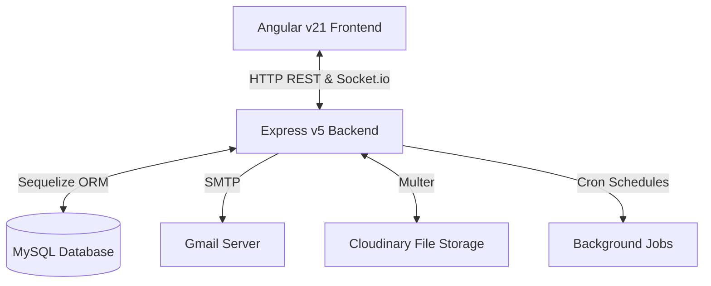
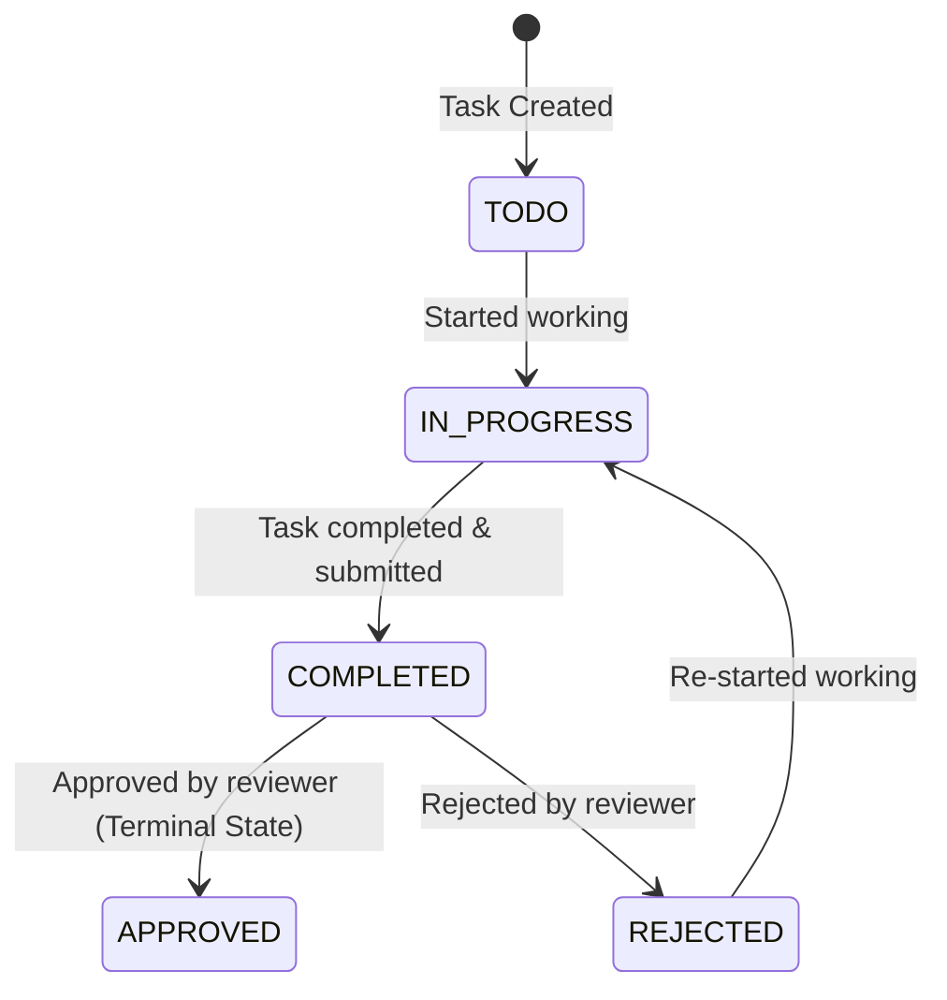

# 🚀 Project Workflow & Task Management System

Welcome to the **Project Workflow & Task Management System**! This is a enterprise-grade, real-time, **Role-Based Access Control (RBAC)** workspace tool designed to streamline organization workflows, task tracking, file attachments, comment systems, and team collaboration.

This document serves as an onboarding guide for new developers and users to quickly understand the project's architecture, technologies, features, directory layout, installation steps, and core workflows.

---

## 🏛️ Project Architecture & Tech Stack

The application is split into a modern decoupled architecture consisting of a Node.js backend API and a single-page Angular frontend application.



### 💻 Frontend
- **Framework:** [Angular v21](https://angular.dev/) (utilizing Server-Side Rendering (SSR), standalone components, type-safe reactive forms, and router guards)
- **Styling:** [Tailwind CSS v4](https://tailwindcss.com/) with PostCSS for highly modern, responsive utility-first layouts
- **State & Signals:** Standard Angular RxJS Observables and modern Angular Signals for local state management
- **Real-Time Client:** [Socket.io-client](https://socket.io/docs/v4/client-api/) for real-time notification socket connections
- **Unit Testing:** [Vitest](https://vitest.dev/) for blazing-fast test suites

### ⚙️ Backend
- **Framework:** [Express.js v5](https://expressjs.com/) (utilizing modern ES Modules `"type": "module"`)
- **Database Access:** [Sequelize ORM](https://sequelize.org/) for object-relational mapping, transactional integrity, and automated schema syncing
- **Database:** [MySQL](https://www.mysql.com/)
- **Real-Time Server:** [Socket.io](https://socket.io/) for bi-directional event-based socket servers
- **Security:** Helmet for securing HTTP headers, CORS for cross-origin management, BCryptJS for password hashing, and JSON Web Tokens (JWT) for authentication
- **File Uploads:** Multer with Cloudinary Storage for managing cloud-based file attachments
- **Background Jobs:** Node-Cron for scheduled workflow processes (due date alerts, overdue status checks)
- **Emails:** Nodemailer for SMTP email alerts

---

## 📋 Prerequisites

Before running the application, make sure your local system has the following installed:
1. **Node.js** (v18.x or higher)
2. **npm** (v9.x or higher)
3. **MySQL Server** (v8.x or higher)
4. A code editor (like **VS Code**)

---

## 🔧 Installation & Database Setup

Follow these steps to get the backend and frontend up and running locally.

### 1. Database Creation
Make sure your MySQL server is running, then log in and create an empty database named `workflow_engine`:
```sql
CREATE DATABASE workflow_engine;
```

> [!NOTE]
> You do **not** need to manually import any SQL tables or schemas! The backend application uses Sequelize's database synchronization features. When you boot the backend, it will automatically connect to MySQL, create all the necessary tables, and seed the default permissions system.

---

### 2. Backend Setup
1. Open a terminal and navigate to the backend subdirectory:
   ```bash
   cd backend/backend
   ```
2. Install the backend dependencies:
   ```bash
   npm install
   ```
3. Verify your backend configurations inside the `.env` file ([backend/backend/.env](file:///D:/task%20management/backend/backend/.env)). The default configuration is:
   ```env
   NODE_ENV=development
   PORT=
   DB_HOST=
   DB_PORT=
   DB_NAME=
   DB_USER=root
   DB_PASSWORD=
   JWT_SECRET=your_jwt_secret_key_here
   JWT_EXPIRES_IN=7d
   CLOUDINARY_CLOUD_NAME=your_cloudinary_cloud_name
   CLOUDINARY_API_KEY=your_cloudinary_api_key
   CLOUDINARY_API_SECRET=your_cloudinary_api_secret
   SMTP_HOST=smtp.gmail.com
   SMTP_PORT=587
   SMTP_USER=your_smtp_email@gmail.com
   SMTP_PASS=your_smtp_app_password
   ```
   *(Adjust database user, password, host, or ports if yours are configured differently).*
4. Start the backend development server (includes hot-reloading with `--watch` mode):
   ```bash
   npm run dev
   ```
   You should see the message:
   ```text
   Database Connected Successfully
   ✅ Permissions Seeded
   All cron jobs started...
   🚀 Server Started Successfully on Port 5000
   ```

---

### 3. Frontend Setup
1. Open a separate terminal and navigate to the frontend directory:
   ```bash
   cd frontend
   ```
2. Install the frontend dependencies:
   ```bash
   npm install
   ```
3. Start the Angular local development server:
   ```bash
   npm start
   ```
4. Once compiled successfully, open your browser and navigate to:
   ```text
   http://localhost:4200/
   ```

---

## 🌟 Core System Workflows

Understanding these core business flows will make using and modifying the application easy.

### 🏢 1. Organization & Admin Registration (Bootstrapping)
The system uses a multi-tenant structure where users and roles belong to an **Organization**. 
- To register a new tenant, go to `http://localhost:4200/register`.
- Provide the **Organization Name**, **Admin Name**, **Admin Email**, and **Password**.
- **Under the hood:** The system creates the `Organization`, creates a default role named `ADMIN`, seeds **all** system permission codes to this role, registers the admin user, and automatically assigns them to this ADMIN role.

### 🔑 2. Role-Based Access Control (RBAC)
This system is completely guarded by dynamic permissions.
- **Roles:** The Admin user can go to the **Roles** tab and create custom roles (e.g., "Developer", "Project Manager", "QC Tester").
- **Permission Assigning:** When editing a role, the admin checks/unchecks specific permission codes (e.g., `CREATE_TASK`, `APPROVE_TASK`, `DELETE_USER`).
- **User Creation:** The Admin can go to the **Users** tab, create new user accounts, and assign them one of the organization's roles.
- **Route & Controller Protection:** Both frontend views and backend API routes are guarded by checking if the user's role contains the required permission code.

### 📝 3. Task Management Lifecycle
Tasks flow through a structured state machine:



1. **Creation:** A user with `CREATE_TASK` creates a task, configuring a title, description, priority, due date, an assigned worker, and a mandatory/optional reviewer.
2. **In Progress:** The assignee marks the task as `IN_PROGRESS` when starting.
3. **Execution:** While active, users can upload files (attachments) hosted on Cloudinary, add comments, and view historical activity logs.
4. **Completion:** The assignee marks the status as `COMPLETED`.
5. **Review Queue:** The assigned reviewer accesses the **Review Queue** tab, reviews the task deliverables, and either clicks **Approve** (marks task `APPROVED`) or **Reject** (marks task `REJECTED` and redirects back to the worker).

### 🔔 4. Real-Time Socket Notifications
The application establishes a Socket.io socket connection upon logging in. 
- Notifications are created dynamically on the backend for events like: task assignment, task due reminders, comments, and status reviews.
- When a notification is generated in the database, the server checks the active socket connection map and instantly emits a `notification` socket event, causing a toaster notification to pop up in the frontend header in real-time.

### ⏰ 5. Background Cron Jobs
Three hourly/daily automated background jobs run on the server:
- **Due Date Reminders:** Runs every 6 hours; notifies task assignees via system alert if a task is due tomorrow.
- **Task Reminders:** Runs every 12 hours; reminds users to continue working on tasks currently marked as `IN_PROGRESS`.
- **Overdue Status Checker:** Runs every hour; finds active tasks whose due date has passed. If overdue, the system flips `isDelayed = true` to flag the delay (visible on the frontend dashboard & task cards).

---

## 📂 Project Directory Structure

Here is a breakdown of the repository's files to help you locate source code quickly:

### ⚙️ Backend Directory Layout
The backend files are nested under `backend/backend/src/`:
- [src/server.js](file:///D:/task%20management/backend/backend/src/server.js) — Backend entrypoint. Syncs tables, seeds default system permissions, starts the HTTP/socket servers, and initiates background cron jobs.
- [src/app.js](file:///D:/task%20management/backend/backend/src/app.js) — Configures Express server middleware (cors, helmet, morgan, express.json) and registers `/api/v1` routes.
- 📁 **`config/`** — Configures core integrations like Cloudinary, Sequelize connection pool, environment variables validation (Zod), and Nodemailer.
- 📁 **`models/`** — Defines Sequelize database schemas (User, Task, Role, Permission, Notification, Comment, Attachment, Activity).
- 📁 **`controllers/`** — Resolves REST API requests, calls services, and formats JSON responses.
- 📁 **`services/`** — Houses core business logic, database queries, transactions, and notification triggers.
- 📁 **`routes/`** — Defines API endpoints and registers permissions-checking middleware.
- 📁 **`middleware/`** — Contains token validation (`auth.middleware.js`), role permission guard (`authorize.middleware.js`), field validator (`validation.middleware.js`), and centralized error-handling.
- 📁 **`socket/`** — Coordinates Socket.io listener endpoints and keeps track of active users' sockets.
- 📁 **`jobs/`** — Configures the node-cron schedulers.
- 📁 **`constants/`** — Enumerates HTTP status codes, activity logs, and permission values ([permissions.js](file:///D:/task%20management/backend/backend/src/constants/permissions.js)).

### 💻 Frontend Directory Layout
The frontend files are nested under `frontend/src/app/`:
- 📁 **`core/`** — Application configuration singletons:
  - **`guards/`** — Protects routes based on login status (`auth.guard.ts`) and RBAC permissions (`permission.guard.ts`).
  - **`interceptors/`** — Automatically attaches JWT tokens to outgoing HTTP headers (`auth.interceptor.ts`).
  - **`services/`** — Houses API requests for auth, dashboard metrics, tasks, roles, notifications, socket connections, and users.
- 📁 **`features/`** — High-level functional modules with components, HTML templates, and CSS styling:
  - **`auth/`** — Login and tenant organization registration interfaces.
  - **`dashboard/`** — Workspace overview, metrics cards, delayed task status lists.
  - **`tasks/`** — Task list, task creation modals, comments, attachment upload, and detail views. Also manages the **Review Queue** and **My Tasks**.
  - **`roles/`** — List, creation, and permission configuration boards.
  - **`users/`** — Team directory, new user creation, and role switching.
  - **`notifications/`** — Global real-time and historical notification centers.
  - **`profile/`** — User detail profile management and password change.
- 📁 **`layout/`** — Structural layout templates:
  - **`shell/`** — Main wrapper including Sidebar navigation and Header.
- 📁 **`shared/`** — Global reusable components (modals, search-filters, load-spinners, custom directives).

---

## 📡 API Endpoints Overview

The backend exposes the following API routes mounted under `/api/v1`:

| Route Prefix | Purpose | Auth Required | Key Endpoints |
|---|---|---|---|
| `/auth` | Handles accounts registration & credentials | No | `POST /register`, `POST /login`, `POST /change-password` |
| `/user` | Manages tenant users profile and roles | Yes | `GET /`, `POST /`, `PATCH /:id`, `DELETE /:id`, `GET /online-users` |
| `/role` | Manages role permission sets | Yes | `GET /`, `POST /`, `PUT /:id`, `DELETE /:id` |
| `/permission` | Lists system permissions catalog | Yes | `GET /` |
| `/task` | Workflow task CRUD & assignments | Yes | `GET /`, `POST /`, `PATCH /:id`, `DELETE /:id` |
| `/taskComment` | Adds feedback comments on tasks | Yes | `GET /task/:taskId`, `POST /`, `DELETE /:id` |
| `/taskAttachment`| Manages file attachments | Yes | `POST /`, `DELETE /:id` |
| `/taskActivity` | Audits task history logs | Yes | `GET /task/:taskId` |
| `/dashboard` | Computes statistics metrics | Yes | `GET /` |
| `/notification` | System alert status updates | Yes | `GET /`, `PATCH /:id/read`, `PATCH /read-all` |

---

## 🛠️ Troubleshooting FAQ

#### 🛑 Error: `Database Connection Failed` when starting the Backend
- **Cause:** MySQL server is not running, or database connection settings inside [backend/backend/.env](file:///D:/task%20management/backend/backend/.env) are incorrect.
- **Solution:** Verify MySQL is running locally (run `mysql -u root` in cmd). Double-check the host, port, username, and password parameters in `.env`. Ensure you ran `CREATE DATABASE workflow_engine;` beforehand.

#### 🛑 Error: Cloudinary upload fails
- **Cause:** Cloudinary credentials in `.env` are invalid or missing.
- **Solution:** The preset credentials in `.env` are pre-activated for development. Ensure your network has outgoing access or check for firewall restrictions blocking `cloudinary.com` requests.

#### 🛑 Error: Real-time notification socket disconnects or does not fire
- **Cause:** Port conflict, or browser CORS blocking websocket upgrade.
- **Solution:** Ensure the backend is running on port `5000` and the socketUrl in the frontend environment configurations ([frontend/src/environments/environment.ts](file:///D:/task%20management/frontend/src/environments/environment.ts)) is correctly pointing to `http://localhost:5000`.

#### 🛑 Error: Angular compilation failure or TypeScript compiler issues
- **Cause:** Node versions conflict or outdated packages in `node_modules`.
- **Solution:** Delete `node_modules` and `package-lock.json` in the `frontend` folder, verify `node -v` shows version 18 or 20+, and run `npm install` again.

---

## 🤝 Contribution Guidelines
When implementing new features or making changes:
1. **Models Synchronization:** When adding or updating attributes on models in `src/models/`, ensure corresponding relationships in [src/models/index.js](file:///D:/task%20management/backend/backend/src/models/index.js) are properly declared, as Sequelize syncs database structures on launch.
2. **Permissions Integration:** If introducing a new API endpoint or user action, add a matching permission code to [permissions.js](file:///D:/task%20management/backend/backend/src/constants/permissions.js) (backend) and [permissions.constant.ts](file:///D:/task%20management/frontend/src/app/core/constants/permissions.constant.ts) (frontend) to ensure RBAC guards block unauthorized traffic.
3. **Real-time Notifications:** Trigger notifications via the `sendNotification` utility in [notification.service.js](file:///D:/task%20management/backend/backend/src/services/notification.service.js) to push events to active users.
